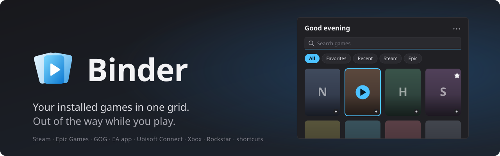
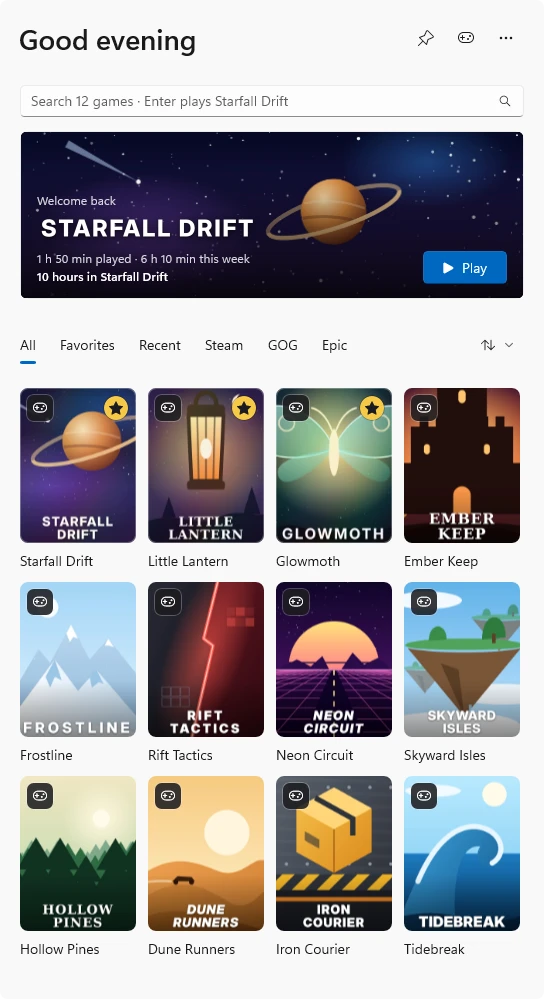
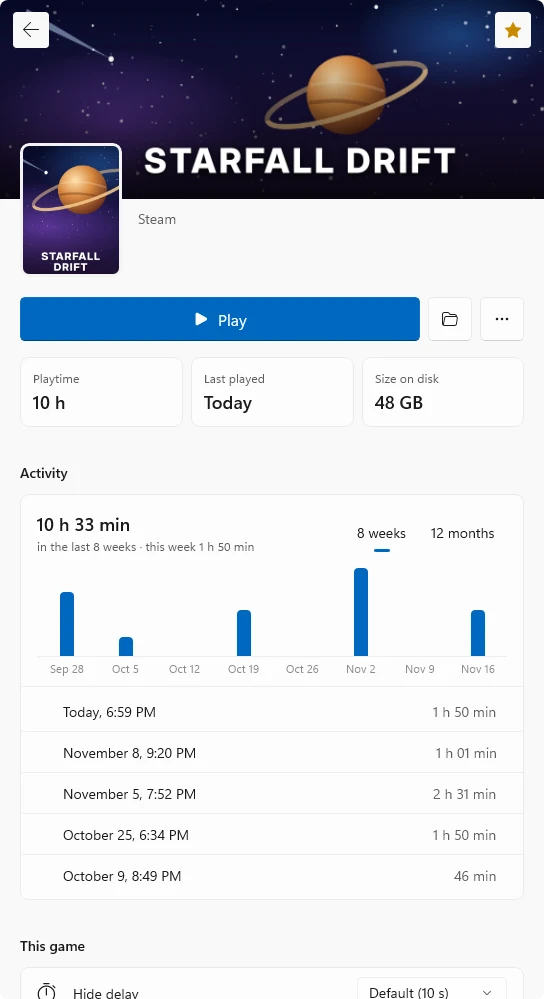
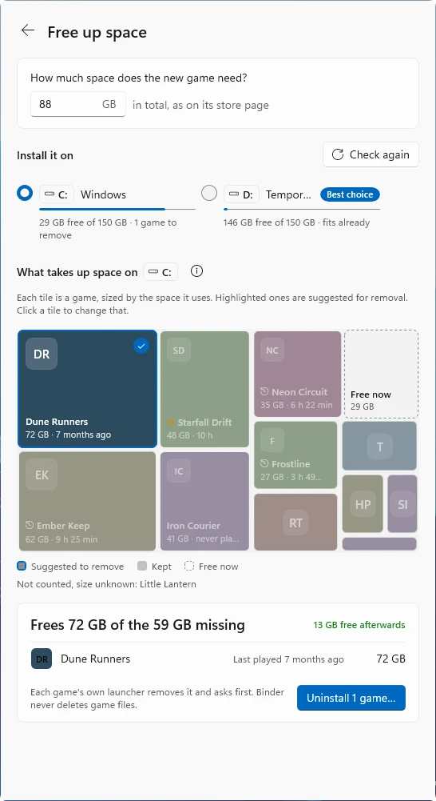
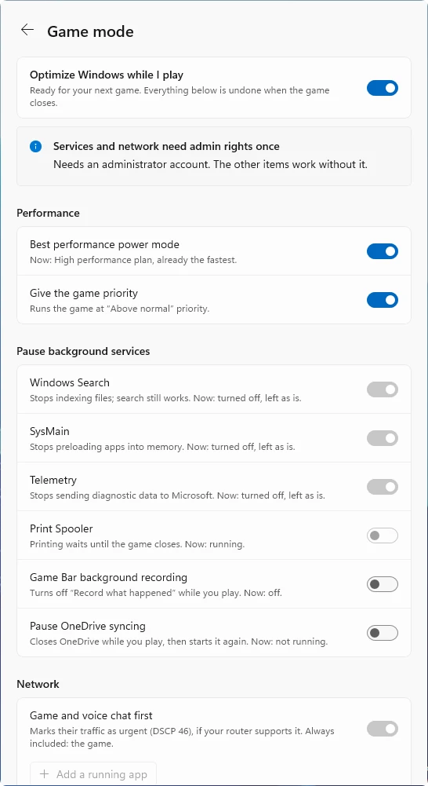

# Binder

A small Windows 10/11 app that replaces the game shortcuts on your desktop. It shows the games you have
installed as a clean cover grid, starts them with one click, gets completely out of the way while you play, and
comes back when the game closes.

<p align="center">
  <a href="https://github.com/JannisJostBot/binder/releases/latest"></a>
</p>

> **AI-generated code, provided as is.** See the [disclaimer](#disclaimer) below.

## Screenshots

Binder itself, with made-up games (light or dark, following your GitHub theme). The pictures are taken by CI on a
Windows machine ([`site-screenshots.yml`](.github/workflows/site-screenshots.yml)).

<table>
  <tr>
    <td align="center" width="25%">
      <picture>
        <source media="(prefers-color-scheme: dark)" srcset="site/screenshots/dark-welcome-back.webp">
        
      </picture>
      <br><b>Back from a game</b>
    </td>
    <td align="center" width="25%">
      <picture>
        <source media="(prefers-color-scheme: dark)" srcset="site/screenshots/dark-detail.webp">
        
      </picture>
      <br><b>A game's page</b>
    </td>
    <td align="center" width="25%">
      <picture>
        <source media="(prefers-color-scheme: dark)" srcset="site/screenshots/dark-free-up-space.webp">
        
      </picture>
      <br><b>Free up space</b>
    </td>
    <td align="center" width="25%">
      <picture>
        <source media="(prefers-color-scheme: dark)" srcset="site/screenshots/dark-game-mode.webp">
        
      </picture>
      <br><b>Game mode</b>
    </td>
  </tr>
</table>

## What it does

- **Finds your games:** Steam, Epic Games, GOG, EA app, Ubisoft Connect, the Xbox app (Game Pass), the
  Rockstar Games Launcher and the Hytale Launcher, plus desktop shortcuts you import and games you add yourself. Covers come from the
  store, or are generated from the game's icon.
- **Opens like part of Windows:** a flyout from the notification-area icon or **Win+Shift+G**. It can also sit
  docked on the desktop, behind your windows.
- **Costs nothing while you play:** a few seconds after a game starts, Binder exits completely. Only a tiny
  watcher (about 3 MB of memory, no CPU) waits for the game to close, records your playtime and brings the shelf
  back.
- **Tidies your desktop:** moves the game shortcuts you pick into its own folder. They're never deleted, and
  can be put back anytime.
- **Shelf:** search, filters per launcher, favorites, "Continue playing" or "This week", sorting, four cover
  sizes.
- **Game details:** playtime with weekly and monthly charts, last played, size on disk, recent sessions, launch
  options (with suggestions for the game's engine), an anti-cheat check, per-game hide delay, process to watch
  and custom cover.
- **Crash detection:** when a game crashes, Binder says so when it comes back, with the likely cause and
  what to try, read from Windows' own event log. Per game, it can also start the game again after a crash (at
  most twice in a row).
- **Game mode** (off by default): puts Windows in its best performance mode while you play and puts everything
  back afterwards (see [Status](#status) for the details).
- **Free up space:** type the size of a game you want to install, and it suggests which games to remove on
  which drive (the ones you play least first), shown as a map of what takes up the space. Each game is removed
  through its own launcher, which asks first. Binder never deletes game files itself.
- **Light on your PC:** no background timers or polling. While it waits in the tray, it uses about 12 MB of
  memory and no CPU.

Dark and light mode, your Windows accent color, keyboard and Xbox controller navigation, screen-reader names,
per-monitor DPI and "Animation effects off" are all respected. Binder speaks English, German and French, following
your Windows display language.

## Install

You need Windows 10 or 11 (x64). Nothing else: the app carries its own runtimes.

1. Download the setup (`BinderSetup-<version>.exe`) from the [latest release](https://github.com/JannisJostBot/binder/releases/latest),
   or build it yourself (see below).
2. Run it and click **Install**. It installs for your account only and never asks for administrator rights.
   (Only Game mode's service and network options do, once, if you choose to allow them in its settings.)
3. Binder opens and walks you through a short first-time setup.

To **update**, Binder checks this repository's GitHub releases once a day when it opens and asks before installing
(Settings › About › Updates: Install automatically, Ask before installing, or Don't check). You can also run a newer
`BinderSetup.exe` yourself. Either way it works even while Binder or a game is running. To
**uninstall**, use Settings → Apps → Binder. It removes everything Binder put on your PC; it asks whether to
put your imported shortcuts back on the desktop (the default) and whether to delete your game list too.

All the details, including silent install options and how the installer works, are in
[docs/installer.md](docs/installer.md).

Because the setup isn't code-signed, Windows SmartScreen may warn about a downloaded copy ("Windows protected
your PC" → More info → Run anyway).

## Build it yourself

Requirements: the .NET 10 SDK, and the "Desktop development with C++" workload from Visual Studio or the Build
Tools (for Native AOT). Then, in PowerShell:

```powershell
./scripts/publish.ps1  # publish\BinderSetup.exe, plus the portable Binder.exe and Binder.Watcher.exe
dotnet build           # a normal development build into bin\
dotnet run --project tests/Binder.Tests -c Release   # unit tests
```

A build of your own doesn't check for updates: only the official releases have the repository and the signing keys
compiled in. A fork that publishes its own releases builds with
`./scripts/publish.ps1 -Repository you/binder -UpdateKeys <your public keys>` (see
[docs/installer.md](docs/installer.md#forks)).

CI (`.github/workflows/ci.yml`) builds and tests every push on a real Windows machine. That includes a UI smoke
test and an installer test.

Don't run `tests/smoke.ps1` or `tests/setup-test.ps1` on your own PC. They replace your Binder data and
Steam settings with test data, and are meant for CI only.

## Dependencies

Binder uses as little as it can: two NuGet packages, both from Microsoft, and Windows itself. Each new one
needs the owner's approval (`CLAUDE.md`, "Dependencies policy"); the versions are pinned exactly.

**In the installed app** (licenses in [THIRD-PARTY-NOTICES.txt](THIRD-PARTY-NOTICES.txt) and the install
folder's `licenses` folder):

| Component | Version | What for | License |
|---|---|---|---|
| .NET runtime | 10 | Compiled into every exe by Native AOT | MIT |
| Windows App SDK: WinUI 3 (`Microsoft.WindowsAppSDK.WinUI`) | 2.6.4 | The panel's UI. Brings `Microsoft.WindowsAppSDK.Base`, `.Foundation` and `.InteractiveExperiences` 2.6.4 | Microsoft Software License Terms for the Windows App SDK |
| WebView2 SDK (`Microsoft.Web.WebView2`) | 1.0.3719.77 | Brought along by WinUI; Binder doesn't use it | BSD-style |
| Win2D (`Microsoft.Graphics.Win2D`) | 1.4.0 | Only the Game mode toast's melt animation | MIT |

Only the widget (`Binder.exe`) uses packages. The watcher, the Game mode helper and the setup use nothing but the
.NET runtime and Windows. Everything else comes from Windows' own system DLLs in System32 (for example XInput for
controllers, GDI+ for the ring when ending a stuck game, the Task Scheduler and WMI for Game mode's admin part).
Nothing else needs to be installed, not even the WebView2 Runtime.

**Only to build it** (nothing from these is shipped):

| Tool | Version | What for |
|---|---|---|
| .NET SDK | 10.0.x (`global.json`) | Building, including `Microsoft.NET.ILLink.Tasks` for trimming |
| Visual Studio or Build Tools, "Desktop development with C++" | current | The Native AOT linker |
| `Microsoft.Windows.SDK.BuildTools` (and `.MSIX`) | 10.0.26100.4654 (1.7.251221100) | Brought along by WinUI for its build steps |
| PowerShell | 7 (7.2 for `sign-release.ps1`) | `scripts/` (publish, check, signing) and the CI tests |

**Elsewhere:** the unit tests use no test framework. CI runs on GitHub Actions with these actions, each pinned to a
commit: `actions/checkout`, `actions/setup-dotnet`, `actions/upload-artifact`, `actions/attest-build-provenance`,
`actions/upload-pages-artifact` and `actions/deploy-pages`. The website (`site/`) loads nothing from other servers;
only its release box asks GitHub's API for the latest release. Its pictures are made with Node, Playwright and libavif's
`avifenc` (`tests/Screenshots/`), which aren't part of the app or the website.

## Privacy

- No account, no telemetry, no analytics.
- The only network traffic is downloading cover art over HTTPS from the store CDNs (Steam), and the update check:
  once a day at most, when the panel opens, two small files from this repository's latest GitHub release
  (`release.json` and its signature), plus the new setup when you choose to update. Nothing about you or your PC
  is sent. Settings › About › Updates › **Don't check** turns it off completely.
- An update installs only if it's signed with the owner's own key (kept on a hardware key, never on GitHub) and is
  newer than what's installed; the setup's hash is checked before it starts. It never asks for administrator rights.
- Everything stays on your PC:
  - Settings, library, play history, crash notes and imported shortcuts: `%APPDATA%\Binder\`
  - Cover cache and error log: `%LOCALAPPDATA%\Binder\`
  - The app itself: `%LOCALAPPDATA%\Programs\Binder\`

## Project layout

| Path | What's there |
|---|---|
| `src/Binder/` | The WinUI 3 app: shelf, details, settings, library sources, launcher. |
| `src/Binder.Watcher/` | The tiny game watcher (Native AOT). |
| `src/Binder.Setup/` | The installer, updater and uninstaller (Native AOT). |
| `src/Binder.Elevated/` | Game mode's optional admin helper (Native AOT). |
| `scripts/` | Publish, the pre-commit check and the icon generators (PowerShell). |
| `tests/` | Unit tests, the stand-in game and the CI UI tests. |
| `site/` | The website, published with GitHub Pages. |
| `docs/proposals.md` | Feature specs, the progress table and the owner's decisions. |
| `docs/releases/` | Each release's notes, shown under "What's new". |
| `docs/installer.md` | Building, installing, updating and how the installer works. |
| `docs/manual-testing.md` | The checklist for testing a build on a real PC. |
| `CLAUDE.md` | The project brief and rules the code is written against. |

## Status

Working:
- Steam, Epic, GOG, EA app, Ubisoft Connect, Xbox app, Rockstar Games Launcher and Hytale Launcher; shortcut import and manual
  add.
- Launch → hide → return, with playtime tracking.
- Shelf, details (playtime charts, launch options, anti-cheat check) and settings; the "…" menu and tray items
  for quick actions, and opening a launcher from its filter chip or the tray menu.
- Crash detection, restarting a game after a crash, and Free up space.
- Multi-monitor, the flyout with tray icon and shortcut, first-run setup, and the installer.
- Xbox controllers (XInput).
- Updates from this repository's GitHub releases, signed by the owner.
- English, German and French.
- Game mode (off by default): Best performance power mode, the game at Above normal priority, Game Bar
  background recording paused and chosen apps closed, all put back when the game closes. With admin rights
  allowed once: Windows Search, SysMain, telemetry and (optionally) Print Spooler paused, the game and voice
  chat marked as urgent on the network, cloud uploads slowed down and Windows Update downloads limited.

Planned (see `docs/proposals.md`):
- More launchers (Battle.net, Riot, Amazon, itch.io, Humble, Meta).
- PlayStation and Switch controllers.
- Faster starts from the search box, and smaller speed-ups (see milestones 18, 23 and 24 there).

## Contributing

Code contributions aren't accepted. Translation fixes, security fixes, bug reports and feature requests that fit
the launcher are welcome: see [CONTRIBUTING.md](CONTRIBUTING.md).

## License

Binder is free software under the GNU General Public License, version 3, with an additional permission for
the libraries it bundles ([LICENSE](LICENSE), [LICENSE-EXCEPTION.txt](LICENSE-EXCEPTION.txt)). It includes parts of
Microsoft's .NET, Windows App SDK and Win2D, which stay under their own licenses
([THIRD-PARTY-NOTICES.txt](THIRD-PARTY-NOTICES.txt)); by installing Binder you also agree to the Windows App
SDK's license terms. All the licenses are in the `licenses` folder of the install folder.

## Disclaimer

Binder was built with Claude, Anthropic's AI. Its author designed and directed it and tests every version on
real PCs; the code itself was written by the AI and isn't reviewed line by line by a human developer.

The software is provided **"as is", without warranty of any kind**, express or implied. That includes, but isn't
limited to, the warranties of merchantability, fitness for a particular purpose and non-infringement. In no
event shall the author or anyone involved be liable for any claim, damages or other liability arising from, out
of, or in connection with the software or its use. You use it at your own risk.

Binder isn't affiliated with or endorsed by Valve, Epic Games, CD PROJEKT (GOG), Electronic Arts, Ubisoft,
Rockstar Games, Hypixel Studios, Microsoft or any other
company whose launchers it works with. Their names and icons belong to their owners.

Binder is licensed under the GNU GPL, version 3, with an additional permission for the libraries it bundles. It
includes parts of Microsoft's .NET, Windows App SDK and Win2D, which stay under their own licenses; by installing
Binder you also agree to the Windows App SDK's license terms. The licenses are in the "licenses" folder of the
install folder.
